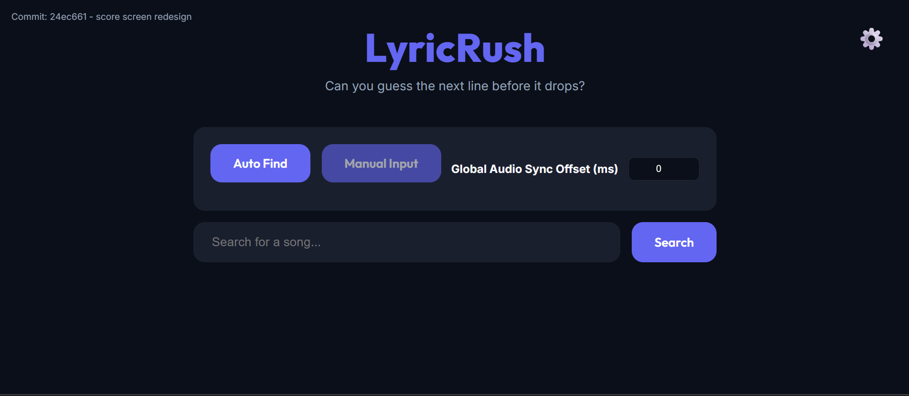
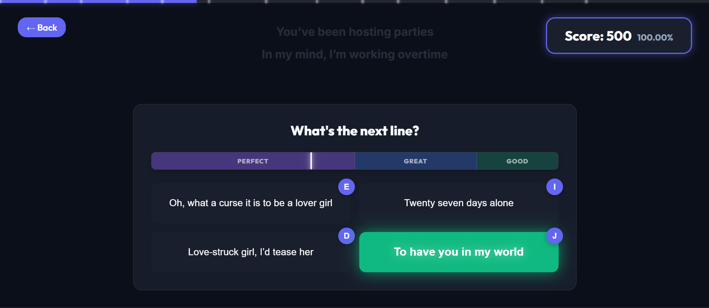

# LyricRush

[https://lyricrush.vercel.app/](https://lyricrush.vercel.app/)



LyricRush is a web-based lyric guessing game built with Next.js. The application plays songs through the YouTube IFrame API and synchronizes lyrics using LRC files. During playback, the game prompts the player to select the correct upcoming lyric line from four options before that line is sung in the audio track.

## Features

- Song search using Deezer and iTunes APIs
- Video matching using `youtube-sr` to find matching YouTube tracks
- Lyric retrieval using the LRCLIB API
- Manual mode for supplying a YouTube video ID and custom LRC text
- Game loop implemented with `requestAnimationFrame` for timestamp comparison
- Decoy option generation using a 2-gram Markov model when unique lyric count is low
- Audio synchronization calibration interface with URL parameter persistence
- Configurable keyboard shortcuts and volume settings

## Game Mechanics

### Question Timing and Multiline Phrases



The game compares the YouTube player time against parsed LRC timestamps inside an animation frame loop. When consecutive lines are separated by less than five seconds, the game bundles them into a phrase. Guessing options become interactive when the first line in the phrase begins, and the timing window closes when the final target line begins

### Scoring
Points are determined by whether the selected option is correct and how early the response is submitted within the active window:

| Rating | Timing Window | Points |
| :--- | :--- | :--- |
| Perfect | Answered within the first 50% of the window | 100 |
| Great | Answered between 50% and 80% of the window | 75 |
| Good | Answered within the final 20% of the window | 50 |
| Miss | Incorrect option selected or time expired | 25 for incorrect choice; 0 on timeout |

### Audio Offset Calibration
Because video uploads often include silent intros or video openings, an offset value in milliseconds is added to the playback time:

1. Open the calibration screen during gameplay
2. Press Left Arrow or Right Arrow to seek playback by five seconds
3. Press Space when a target lyric line is sung
4. The system calculates the time difference and updates a rolling average
5. Exiting calibration saves the offset to the `offset` URL query parameter

## Controls

Default keybindings are:

| Action | Key |
| :--- | :--- |
| Select Option 1 | E |
| Select Option 2 | I |
| Select Option 3 | D |
| Select Option 4 | J |
| Pause or Resume | Escape |
| Calibration: Seek backwards 5 seconds | Left Arrow |
| Calibration: Seek forwards 5 seconds | Right Arrow |
| Calibration: Register timing tap | Space |

Key assignments can be changed in the settings panel.

## Architecture

- Playback is handled by the YouTube IFrame API. Track search metadata is retrieved from Deezer and iTunes. The Spotify API is not used.
- The game loop runs in `src/app/game/page.tsx` via `requestAnimationFrame`. It reads `player.getCurrentTime()` and adds `offsetMs` to evaluate progress against lyric timestamps.
- When lyric data loads, future question intervals are pre-calculated to position markers on the top progress bar.
- UI elements and identifiers are listed in `docs/ui_elements.md`.

## Project Structure

```text
radiant-mendeleev/
├── docs/
│   └── ui_elements.md
├── public/
├── scripts/
│   └── update-version.js
├── src/
│   ├── app/
│   │   ├── api/
│   │   │   ├── lyrics/
│   │   │   ├── search/
│   │   │   └── yt-search/
│   │   ├── game/
│   │   │   └── page.tsx
│   │   ├── globals.css
│   │   ├── layout.tsx
│   │   └── page.tsx
│   ├── components/
│   │   └── SettingsPanel.tsx
│   ├── lib/
│   │   └── useSettings.ts
│   └── version.json
├── package.json
└── tsconfig.json
```

## Getting Started

Primary usage of Lyricrush is through the webapp: [https://lyricrush.vercel.app/](https://lyricrush.vercel.app/), though you can run it locally if you'd like

### Prerequisites
- Node.js (version 18 or later)
- npm

### Installation
Clone the repository and install dependencies:

```bash
git clone https://github.com/your-username/radiant-mendeleev.git
cd radiant-mendeleev
npm install
```

### Development
Start the local Next.js development server:

```bash
npm run dev
```

The application is accessible at `http://localhost:3000`.

### Production Build
To create a production build and start the server:

```bash
npm run build
npm run start
```

The build script runs `scripts/update-version.js` before executing `next build`, storing the latest git commit information in `src/version.json`.
